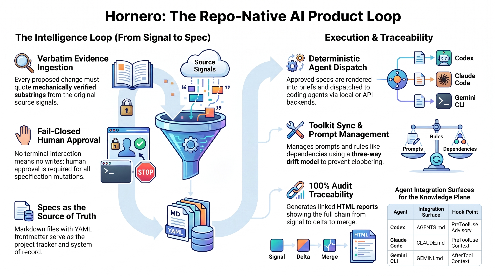

# hornero 🪶

**Repo-native product loop**: requirement signals → living memory → SDD specs
→ dispatched builds → HTML reports. Everything lives in your git repo; nothing
needs a server, a database service, or a SaaS.

> El hornero (ovenbird) builds its own house, layer by layer — so does this
> tool: hornero is developed with the same spec-driven workflow it implements
> (fully self-hosting).



<!-- pypi-release-notes:start -->
## Latest changes

See the [changelog](CHANGELOG.md) for released and upcoming changes. Published
packages replace this block with the exact change set for that immutable PyPI
version.
<!-- pypi-release-notes:end -->

## What it does

```
 meeting notes, docs, ideas          you                     coding agents
        │                             │                            │
        ▼                             ▼                            ▼
 .hornero/inbox/  ──reconcile──▶  HITL review  ──apply──▶  sdd/specs/*.md
        │            (LLM drafts      approve/reject           │
        │             deltas with     /edit/skip               ▼
        │             VERBATIM        in your TTY         hornero build
        │             evidence)                          (spec → brief →
        │                                                 mock/cli backend)
        ▼                                                      │
 .hornero/knowledge/  ◀──reindex──  write-back: code + spec + reports
                                    land in the SAME branch/PR
        ▼
 sdd/reports/*.html   (capabilities, workflows, traceability — offline, deterministic)
```

- **Signals in**: drop meeting notes / docs into `.hornero/inbox/`.
- **Project factory**: create a Git repository and runnable stack from a
  composable, versioned blueprint; lock hashes expose local drift.
- **Reconcile**: an LLM drafts `RequirementDelta`s (NEW / CHANGED / OBSOLETE /
  DUPLICATE) — every delta carries evidence that is a *mechanically verified
  substring* of the source signal. No evidence, no delta.
- **Human gate**: nothing mutates a spec without an interactive approval
  (approve / reject / edit / skip). No TTY → no writes, by design.
- **Specs are the tracker**: markdown files with YAML frontmatter under
  `sdd/specs/`; status transitions and comments are written into the files
  themselves. ADRs in `sdd/decisions/`, low-confidence ideas become brainstorm
  proposals in `sdd/proposals/`.
- **Build**: approved specs are rendered into build briefs and dispatched to a
  coding-agent backend (`mock` by default; `cli`/`api` are explicit opt-ins).
- **Reports**: `capabilities.html`, `workflows.html`, `traceability.html` —
  the full audit chain signal → delta → spec → SDD tasks → PR → merge, with
  honest gaps.
- **SDD toolkit sync**: `hornero sdd install|status|diff|sync` manages your
  `.claude/` + `sdd/` toolkit files against an upstream repo with a committed
  lockfile and a three-way drift model — like a package manager for prompts,
  where **diverged files are never auto-merged**.
- **Agent-facing wiki**: `wiki/` is a second projection of the knowledge
  layer, written FOR the next agent run — watermark-scoped surgical updates,
  anti-stub and link-check gates, and a no-op discipline that makes scheduled
  refreshes churn-free (quiet days produce no PR).
- **Code as signal**: opt-in `GitSource` turns commits into requirement
  signals so specs and code never silently drift apart.
- **Flight recorder & scribe**: every dispatch leaves a redacted action-stream
  trace; the scribe distills it into a Decision Record whose every claim
  cites a verified event range — and past rejections resurface in the HITL
  preview before you approve a repeat.
- **Semantic project graph**: sources, requirements, criteria, controls, tasks,
  code, tests, decisions and findings are connected with source hashes and
  evidence locators. `validate` repairs derived state and fails closed on
  corrupt traceability.
- **Continuous improvement**: deterministic architecture, security,
  compliance, dependency, performance, quality, test, documentation and graph packs
  produce stable findings. Approved low-risk work runs in an isolated Git
  worktree; gates must pass before a review branch is retained.
- **Temporal intelligence**: immutable entity versions, supersession,
  contradiction/duplicate candidates, impact paths, coverage scores,
  explainable queries and token-budgeted context packs.
- **Structural intelligence**: incremental Python/TS/JS/Svelte/SQL facts,
  optional Tree-sitter validation, symbol-level call/import/inheritance edges,
  an offline interactive explorer and diff-to-spec impact overlays.
- **Context economy**: every active trace has exact refs, compact steps and a
  Mermaid canvas; layered recall serves persona/scenario structure first and
  drills down to evidence only within explicit budgets. Repeated conventions
  and SOPs are proposed for HITL review, never auto-installed.
- **Production factory**: signed blueprint registries, three-way upgrades,
  capability resolution, production components, generated contracts and
  federated multi-repository plans.
- **Assurance**: expiring finding baselines, declarative policy packs, offline
  SBOM/vulnerability input, STRIDE threat models and evidence mappings for
  SOC 2, ISO 27001, GDPR and PCI.
- **Autonomous runtime**: signed webhook/schedule events, resource sandbox,
  budgets, retries, risk approvals, provider-neutral PR creation, metrics and
  bounded feedback learning. It never merges a branch.
- **Independent perspectives**: ground one neutral brief in specs, decisions
  and diffs, fan it out concurrently through Multicoders, preserve every
  provider opinion and require explicit finding dispositions.
- **Grounded mockups**: edit a real product screenshot through Codex image
  generation, validate and hash each named PNG view, retain refinement lineage
  and promote only an explicitly reviewed artifact.

## Install

Requires Python ≥ 3.11. Single runtime dependency (`pyyaml`).

```bash
git clone <this-repo> && cd hornero
python -m venv .venv && source .venv/bin/activate
uv pip install -e .            # or: pip install -e .
```

For ai-parrot's LLM-wiki knowledge plane and native coding-agent integration:

```bash
pip install 'hornero[knowledge]'
hornero wiki codex install
hornero wiki claude install        # Claude Code
hornero wiki gemini install        # Gemini CLI
hornero wiki parrot build
```

For Tree-sitter parsing across the optional structural grammar set (native
deterministic analyzers remain available without it):

```bash
pip install 'hornero[structural]'
```

## Quickstart

```bash
hornero new billing-api --blueprint python-service --commit
cd billing-api
hornero ingest product-requirements.docx
hornero reindex
hornero validate
hornero improve scan
hornero improve plan --limit 20
```

For an existing repository:

```bash
cd your-project/
hornero init                   # scaffolds .hornero/ + the sdd/ layout
echo "Users keep asking for CSV export of the usage table" \
  > .hornero/inbox/note-2026-07-08.md
hornero reconcile --dry-run    # see the proposed deltas, writes nothing
hornero reconcile              # review interactively, apply approved deltas
hornero build                  # dispatch approved specs (mock backend)
hornero reindex                # rebuild local knowledge graph + HTML graph report
hornero report                 # regenerate sdd/reports/*.html
hornero status                 # spec counts, inbox, index health
```

Add the shared SDD toolkit (agents, commands, rules, templates):

```bash
hornero sdd install --from <toolkit-repo-or-path>
hornero sdd status             # drift table: current/behind/modified/diverged/...
hornero sdd sync               # fast-forward what's safe; diverged blocks
```

## CLI at a glance

| Command | Purpose |
|---|---|
| `hornero new NAME [--blueprint NAME] [--component NAME]` | Create a Git repository and full Hornero/SDD stack from a versioned blueprint |
| `hornero init [--hooks] [--no-sdd]` | Scaffold `.hornero/` + `sdd/` layout (+ optional post-merge reindex hook) |
| `hornero blueprint list\|status` | List built-ins or report locked blueprint version and file drift |
| `hornero ingest FILE... [--kind KIND]` | Normalize supported documents into the inbox with provenance |
| `hornero validate [--repair] [--json]` | Validate graph schema, provenance, traceability and secret safety |
| `hornero improve scan\|plan\|run\|status` | Detect, prioritize, policy-gate, isolate, verify and ledger improvements |
| `hornero knowledge history\|analyze\|impact\|diff-impact\|coverage\|semantic-query\|explain\|context` | Navigate temporal/structural reasoning, governed diff impact and bounded context |
| `hornero knowledge pyramid\|recall\|persona\|distill-skills` | Inspect layered memory, recall under hard budgets, and create HITL-only proposals |
| `hornero extract FILE` | Propose graph entities from AI output with verbatim evidence gates |
| `hornero blueprint resolve\|upgrade` | Resolve capabilities or apply a signed three-way blueprint upgrade |
| `hornero contracts generate\|check` | Generate OpenAPI, event/data schemas and client contracts |
| `hornero workspace graph\|plan` | Federate repository graphs and calculate cross-repo impact |
| `hornero assurance supply-chain\|threat-model\|compliance` | Generate auditable security and compliance evidence reports |
| `hornero runtime init\|emit\|webhook\|tick\|approve\|feedback\|status` | Operate the bounded event runtime |
| `hornero status` | Spec counts by state, pending inbox, index health |
| `hornero reconcile [--dry-run]` | Poll signals → evidence-verified deltas → HITL → apply |
| `hornero build [SPEC-ID ...] [--backend mock\|cli]` | Approved specs → briefs → dispatch |
| `hornero architecture init\|inventory\|query\|explain\|resolve\|check\|diff` | Discover reusable capabilities and enforce profile-scoped architecture |
| `hornero spec preflight SPEC-ID` | Validate architecture Definition of Ready before build |
| `hornero consult review\|brainstorm\|research\|design-opinion` | Run independent read-only provider perspectives with quorum and audit |
| `hornero consult show\|triage\|resume` | Inspect, dispose or continue advisory findings |
| `hornero mockup create\|show\|refine\|deliver\|promote` | Manage screenshot-grounded visual artifacts and HITL promotion |
| `hornero reindex` | Rebuild `.hornero/knowledge/`: token index + code graph DB + `knowledge-graph.html` |
| `hornero knowledge query\|page\|related\|entity\|relations\|status` | Query file and semantic graph surfaces |
| `hornero report [--only NAME]` | Regenerate the HTML reports |
| `hornero sdd install --from SRC [--ref R] [--force]` | Install toolkit + scaffold + lockfile |
| `hornero sdd status` / `diff [FILE]` | Drift table / unified diff vs upstream |
| `hornero sdd sync [--dry-run] [--theirs F] [--ours F] [--force]` | Pull updates; diverged requires explicit resolution |
| `hornero sdd sync --push FILE...` | Promote improved files upstream via a PR (secret-scanned) |
| `hornero sdd sync --workspace DIR` | Pull-sync every child repo carrying `.hornero/sdd.lock` |
| `hornero sdd hold\|unhold\|pin FILE` | Per-file sync policy |
| `hornero wiki init\|update` | Agent-facing living wiki (watermark-scoped, no-op-disciplined) |
| `hornero wiki parrot build\|upsert\|query\|page\|related\|status\|export` | Operate ai-parrot's local LLM-wiki plane |
| `hornero wiki parrot remember\|note\|link\|memories\|audit\|ground` | Author, audit and ground persistent ai-parrot knowledge |
| `hornero wiki codex install\|status\|uninstall` | Manage query-first Codex instructions, skill and lifecycle hook |
| `hornero wiki claude install\|status\|uninstall` | Manage query-first Claude Code instructions, skill and lifecycle hook |
| `hornero wiki gemini install\|status\|uninstall` | Manage query-first Gemini CLI instructions, skill and lifecycle hook |
| `hornero runs list\|show\|adopt\|canvas\|drilldown\|prune` | Flight-recorder traces, symbolic canvases and exact evidence drill-down |
| `hornero scribe RUN [--force]` | Distill a trace into a Decision Record (verified citations) |

## Hard invariants

1. **Evidence is verbatim or the delta dies** — excerpts are mechanically
   verified substrings of the signal; mismatches are dropped and ledger-logged.
2. **HITL is fail-closed** — no approval channel ⇒ no spec mutation, no
   dispatch. `--dry-run` always leaves `git status` clean.
3. **No billed backend by surprise** — `api` never runs unless it is the
   explicit first entry of `dispatch.backend_order`.
4. **Diverged toolkit files are never auto-merged** — no timestamp heuristics;
   a human resolves with `--theirs` / `--ours` or by hand.
5. **Deterministic tests only** — the suite needs no network, keys, or
   services.

## Documentation

- [Workflow cookbook](docs/WORKFLOWS.md) — reproducible examples from project creation through operations
- [Video script](docs/VIDEO_SCRIPT.md) — narrated end-to-end demonstration plan
- [Infographic cheatsheet source](docs/INFOGRAPHIC_CHEATSHEET.md) — graph-derived command map, examples and visual brief
- [Independent advisory and grounded mockups](docs/COLLABORATION.md) — provider bridge, safety boundaries and commands
- [Usage guide](docs/USAGE.md) — the full loop, configuration, SDD toolkit sync
- [Development guide](docs/DEVELOPMENT.md) — setup, architecture, the self-hosted SDD workflow
- [Deployment guide](docs/DEPLOYMENT.md) — adopting hornero in your repos, CI, multi-repo fanout
- [PyPI release runbook](docs/RELEASING.md) — trusted automatic publishing from master
- [Changelog guide](docs/CHANGELOGS.md) — fragments, PR policy and PyPI projection
- [ai-parrot LLM-wiki guide](docs/PARROT_WIKI.md) — knowledge bridge for Codex, Claude Code and Gemini CLI
- [Structural intelligence and context economy](docs/STRUCTURAL_MEMORY.md) — symbols, diff impact, canvases, layered recall and governed distillation
- [Changelog](CHANGELOG.md)
- [Visual artefacts](docs/artefacts/) — architecture diagram, infographic, cheatsheet, interactive onboarding (English + Spanish)

Specs are the source of truth: see `sdd/specs/`.

## License

[MIT](LICENSE)
